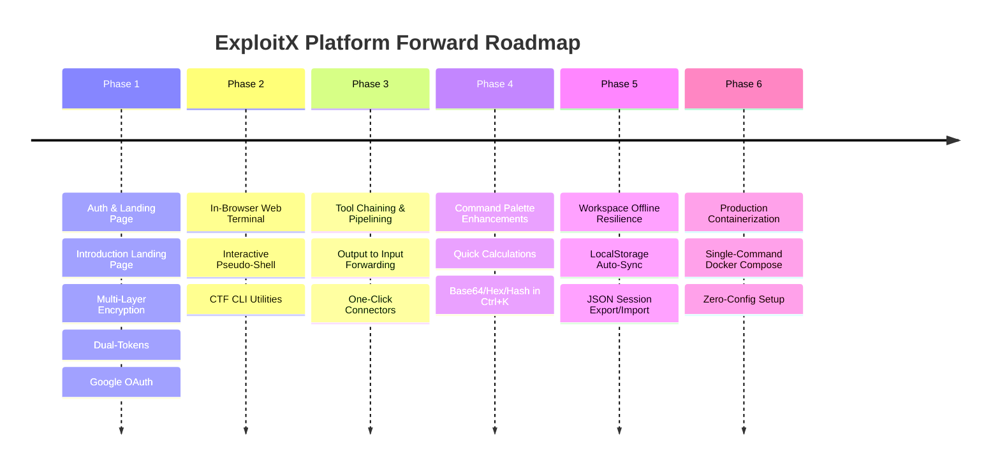

# 🚀 ExploitX CTF Platform — Master Implementation Roadmap

> **Current Status**: All **64 / 64 Tools** across 7 domains are **100% completed and verified** with dedicated custom screens and backend engine tests.  
> **Immediate Focus**: Enterprise Multi-Layer Authentication, Dual-Tokens (JWT + Session), Google OAuth2 Sign-In, and Introduction Landing Page.  
> **On-Hold Status**: Challenges & Competitive Scoring side is temporarily paused per user decision.

---

## 📊 Executive Progress Dashboard

| Domain / Layer | Tools / Units | Backend Engine Status | Frontend UI Status | Test Coverage | Overall Status |
| :--- | :---: | :---: | :---: | :---: | :---: |
| **1. Cryptography** | 17 / 17 | `CryptoEngineService` | 17 Custom Screens | 16 Tests Passed | ✅ **100% Complete** |
| **2. Network & OSINT** | 5 / 5 | `NetworkEngineService` | 5 Custom Screens | 9 Tests Passed | ✅ **100% Complete** |
| **3. Web Exploitation** | 8 / 8 | `WebEngineService` | 8 Custom Screens | 7 Tests Passed | ✅ **100% Complete** |
| **4. Forensics & Stego** | 12 / 12 | `ForensicEngineService` | 12 Custom Screens | 5 Tests Passed | ✅ **100% Complete** |
| **5. Reverse & Pwn** | 13 / 13 | `ReverseEngineService` | 13 Custom Screens | 5 Tests Passed | ✅ **100% Complete** |
| **6. Reference Guides** | 2 / 2 | Client Reference | 2 Custom Screens | Verified in Vitest | ✅ **100% Complete** |
| **7. Workspace Utilities** | 7 / 7 | `WorkspaceController` | 7 Custom Screens | Verified in Vitest | ✅ **100% Complete** |
| **TOTAL TOOLS** | **64 / 64** | **5 Engines + Controller** | **64 Dedicated Pages** | **43 Backend + 9 Frontend** | **✅ 100% TOOLKIT DONE** |

---

## 🛠️ Complete Inventory of Implemented Tools (64 / 64)

### 1. Cryptography Suite (17 Tools)
- [x] **Multi Decoder** (`/cryptography/multi-decoder`): Cascading auto-detection and multi-stage decoding.
- [x] **XOR Toolkit** (`/cryptography/xor`): Single-byte brute force, repeating-key XOR, and frequency scoring.
- [x] **Hash Utilities** (`/cryptography/hash-utilities`): MD5, SHA-1, SHA-256, SHA-512, NTLM generation and heuristic identifier.
- [x] **Encoding Lab** (`/cryptography/encoding-lab`): Base32, Base58, Base64, Base85, Hex converters.
- [x] **Number Converter** (`/cryptography/number-converter`): Decimal, Hexadecimal, Octal, Binary, ASCII, IEEE-754 float.
- [x] **RSA Helper** (`/cryptography/rsa-helper`): Prime factors, Euler totient $\phi(n)$, modular inverse $d$.
- [x] **Atbash Cipher** (`/cryptography/atbash-cipher`): Symmetric Hebrew alphabet substitution.
- [x] **Rail Fence Cipher** (`/cryptography/rail-fence-cipher`): Zig-zag transposition cipher solver.
- [x] **Baconian Cipher** (`/cryptography/baconian-cipher`): 5-bit binary steganographic cipher decoder.
- [x] **Bitwise Calculator** (`/cryptography/bitwise-calculator`): Interactive visual bitwise operator playground (AND, OR, XOR, NOT, shifts, rotates).
- [x] **RSA Attack Lab** (`/cryptography/rsa-attack-lab`): Wiener low private exponent attack & Fermat close prime factorization.
- [x] **Vigenère Solver** (`/cryptography/vigenere-solver`): Automated Index of Coincidence (IoC) key length deduction & frequency analysis.
- [x] **Padding Oracle Simulator** (`/cryptography/padding-oracle-simulator`): PKCS#7 CBC decryption stepping simulator.
- [x] **Substitution Cipher Solver** (`/cryptography/substitution-cipher-solver`): Monoalphabetic frequency analysis & letter substitution map.
- [x] **Discrete Logarithm Solver** (`/cryptography/discrete-logarithm-solver`): Baby-step Giant-step algorithm for modular discrete log.
- [x] **Crib Dragging Cracker** (`/cryptography/crib-dragging-cracker`): Two-time pad (OTP reuse) interactive crib dragging.
- [x] **Caesar 25-Shift Table** (`/cryptography/caesar-25-shift-table`): Real-time simultaneous display of all 25 Caesar shifts.

### 2. Network & OSINT Suite (5 Tools)
- [x] **CIDR Subnet Calculator** (`/network/cidr-subnet-calculator`): IPv4/IPv6 address decomposition, network/broadcast range, netmask and wildcard calculations.
- [x] **OSINT Multi-Target Workspace** (`/network/osint-multi-target-workspace`): Shodan, VirusTotal, Censys, ViewDNS, GreyNoise multi-target hub.
- [x] **Wordlists & SecLists Catalog** (`/network/wordlists-seclists-catalog`): Download & reference catalog for SecLists, RockYou, and directory wordlists.
- [x] **Domain & Whois Reference Guide** (`/network/domain-whois-reference-guide`): Registrar fields, TLD policies, and DNS record type reference.
- [x] **Live DNS Record & Socket Lookup** (`/network/live-dns-record-socket-lookup`): Live TCP Port 43 WHOIS queries & DNS record lookup engine.

### 3. Web Exploitation Suite (8 Tools)
- [x] **JWT Analyzer & Exploit Lab** (`/web/jwt-analyzer`): Header/claims editor, signature verification, `alg: none` exploit generator.
- [x] **Web Attack Payload Generator** (`/web/web-attack-payload-generator`): Curated payloads across XSS, SQLi, SSRF, LFI/RFI, SSTI, Command Injection.
- [x] **HTTP Request & Header Security Auditor** (`/web/http-request-header-security-auditor`): Security header analyzer (CSP, HSTS, X-Frame, CORS).
- [x] **Regex Tester** (`/web/regex-tester`): Interactive regex debugger with live match highlighting and CTF pattern presets.
- [x] **URL Parser & Parameter Decomposer** (`/web/url-parser-parameter-decomposer`): Protocol, host, path, query parameters table, fragment decomposition.
- [x] **User-Agent Fingerprint Analyzer** (`/web/user-agent-fingerprint-analyzer`): Client browser, OS, hardware architecture, engine identification.
- [x] **HTTP Status Codes CTF Guide** (`/web/http-status-codes-ctf-guide`): Complete RFC status catalog with CTF exploitation insights.
- [x] **SSTI & SQLi Filter Bypass Playground** (`/web/ssti-sqli-filter-bypass-playground`): Jinja2/Twig/SpEL template filter evasion & SQLi bypass transformer.

### 4. Forensics & Steganography Suite (12 Tools)
- [x] **File Magic Byte Analyzer** (`/forensics/file-magic-byte-analyzer`): Hex signature identifier for headers and footers.
- [x] **Timestamp Converter** (`/forensics/timestamp-converter`): Unix epoch (s/ms), Windows 64-bit FILETIME, UUIDv1, ISO 8601 converter.
- [x] **PNG IHDR Chunk & CRC Fixer** (`/forensics/png-ihdr-chunk-crc-fixer`): Automatically corrects truncated image dimensions and recalculates CRC-32.
- [x] **Steg Command Assistant** (`/forensics/steg-command-assistant`): Syntax generator for `steghide`, `zsteg`, `binwalk`, `foremost`, `exiftool`.
- [x] **MIME Type & Magic Signatures Reference** (`/forensics/mime-type-magic-signatures-reference`): Searchable database of 100+ binary file signatures.
- [x] **Default Credentials Database** (`/forensics/default-credentials-database`): Searchable factory credentials for routers, cameras, CMS, and databases.
- [x] **LSB Bitplane Steganography Reader** (`/forensics/lsb-bitplane-steganography-reader`): Visualizes R/G/B 0–7 bitplanes to detect concealed images/text.
- [x] **Base64 Media Extractor** (`/forensics/base64-media-extractor`): Auto-detects, decodes, and previews embedded Data-URI images, audio, and SVG.
- [x] **EXIF Metadata Reference** (`/forensics/exif-metadata-reference`): Guide to GPS coordinate tagging, camera models, and hidden timestamps.
- [x] **PCAP Stream Inspector** (`/forensics/pcap-stream-inspector`): Reconstructs TCP/HTTP sessions and extracts raw transferred files from PCAP dumps.
- [x] **Magic Byte File Carver** (`/forensics/magic-byte-file-carver`): Scans raw binary dumps and carves out embedded JPEGs, PNGs, and ZIPs.
- [x] **ZIP Password Cracker** (`/forensics/zip-password-cracker`): Multi-threaded dictionary attack runner for password-protected ZIP archives.

### 5. Reverse Engineering & Pwn Suite (13 Tools)
- [x] **De Bruijn Cyclic Pattern Generator & Offset Finder** (`/reverse/de-bruijn-cyclic-pattern-generator-offset-finder`): Generates unique 20,000-char non-repeating sequences and calculates buffer crash offsets.
- [x] **Endianness Converter** (`/reverse/endianness-converter`): 16/32/64-bit Big-Endian vs Little-Endian visual byte swapper.
- [x] **Linux Syscall Reference Table** (`/reverse/linux-syscall-reference-table`): Linux x86_64 kernel syscall reference (0–60) with registers (`rax`, `rdi`, `rsi`, `rdx`).
- [x] **Pwntools Script Template Generator** (`/reverse/pwntools-script-template-generator`): Python exploit script builder for ret2win, ROP, shellcode execution.
- [x] **Brainfuck Interpreter** (`/reverse/brainfuck-interpreter`): 30,000-cell virtual machine emulator with memory tape visualizer.
- [x] **ASM Assembly Reference** (`/reverse/asm-assembly-reference`): x86/x64 instruction cheat sheet (data movement, arithmetic, logic, branching).
- [x] **ROP Gadget Cheat Sheet** (`/reverse/rop-gadget-cheat-sheet`): Common ROP gadgets (`pop rdi; ret`, `ret`, `syscall`) and stack pivoting techniques.
- [x] **Format String Offset Generator** (`/reverse/format-string-offset-generator`): `%p.%p.%p` stack leak patterns and direct parameter access (`%n$p`).
- [x] **Binary Structure Overview** (`/reverse/binary-structure-overview`): Interactive ELF and PE header layout maps.
- [x] **ASCII 0-255 Table** (`/reverse/ascii-0-255-table`): Complete decimal, hex, octal, binary conversions with control character meanings.
- [x] **C/C++ Data Type Sizes Reference** (`/reverse/c-c-data-type-sizes-reference`): Cross-platform 32-bit vs 64-bit architecture memory layouts.
- [x] **Shellcode Catalog** (`/reverse/shellcode-catalog`): Ready-to-use tested Linux x86/x64 and Windows shellcodes with bad-char filters.
- [x] **Stack Frame & Buffer Offset Assistant** (`/reverse/stack-frame-buffer-offset-assistant`): Visualizes stack frame growth, local variables, saved RBP, and return address.

### 6. Reference Guides (2 Tools)
- [x] **Kali Linux Commands Database** (`/reference/kali-linux-commands-database`): Searchable database of 80+ Kali commands categorized across 8 attack phases with flag breakdowns.
- [x] **Google Dork Generator** (`/reference/google-dork-generator`): Interactive constructor for `site:`, `filetype:`, `intitle:`, `inurl:`, `intext:`, and 8 CTF presets with 1-click Google search.

### 7. Workspace Utilities (7 Tools)
- [x] **Notes & Scratchpad** (`/workspace/notes-scratchpad`): Full-page markdown scratchpad with dual edit/preview, tags, search, pin/unpin, and `.md` export.
- [x] **Text Utilities** (`/workspace/text-utilities`): Real-time Shannon Entropy calculator, 8 case converters, line deduplication, sorting, and regex replace.
- [x] **Text Diff Checker** (`/workspace/text-diff-checker`): Side-by-side and unified line-by-line diff comparator with similarity ratio calculation.
- [x] **QR Code Reference & Generator** (`/workspace/qr-code-reference`): Zero-dependency SVG/PNG QR generator with inverted stego mode and forensic anatomy guide.
- [x] **Flag Hunter** (`/workspace/flag-hunter`): Multi-stage deep extraction pipeline with automatic Base64 and Hex stream decoding.
- [x] **Command Palette & Hotkeys Guide** (`/workspace/command-palette`): Searchable catalog of all 64 tools with category filtering and keyboard shortcuts reference.
- [x] **CTF Write-Up Markdown Generator** (`/workspace/ctf-write-up-markdown-generator`): Form wizard generating structured writeup documentation with live preview and `.md` download.

---

## 🎯 Active Forward Roadmap (Operator & Platform Focus)

---

### 🟢 Phase 1: Enterprise Multi-Layer Authentication, Dual-Tokens, Google OAuth & Introduction Landing Page (CURRENT PRIORITY)

- [ ] **1.1 Website Introduction Landing Page (`/`)**:
  - High-impact cyber-themed homepage introducing ExploitX to new visitors.
  - Value proposition headline, live tool statistics (64 tools across 7 disciplines).
  - Core Pillars Showcase: 64 Focused Security Tools, Real-Time Operator Workspace, In-Browser Web Terminal, Hardened Security.
  - Interactive Live Tool Spotlight (instant mini-decoder demonstration widget).
  - Call-To-Action (CTA) funnels: "Explore Public Tools as Guest", "Create Operator Account", "Sign In with Google".
  - Routing: Unauthenticated visitors see the Landing Page; authenticated operators transition to the active Dashboard.
- [ ] **1.2 Multi-Layer Database Password Encryption**:
  - Implement `MultiLayerPasswordEncoder` in Spring Boot:
    - **Layer 1**: Server-side HMAC-SHA512 cryptographic pepper key (`app.security.pepper`).
    - **Layer 2**: Adaptive high-cost BCrypt (cost factor 12) on top of the peppered password.
  - Protects user passwords from database leaks and GPU rainbow-table clusters.
- [ ] **1.3 Dual-Token Strategy (JWT + Session Tokens)**:
  - **Stateless JWT Access Token**: Short-lived (15–60 min) for performant REST API authorization.
  - **Persistent `UserSession` Document**: Stored in MongoDB for 30-day "Remember this device" sessions.
  - Endpoint `POST /api/auth/refresh`: Silently exchange valid session token for fresh JWT.
  - Remote Session Management: Endpoint `GET /api/auth/sessions` and `POST /api/auth/logout` to revoke individual or all active devices.
- [ ] **1.4 Google OAuth2 Sign-In Integration**:
  - Branded Google Sign-In button on both `/login` and `/register` pages.
  - Backend endpoint `POST /api/auth/google`: Verifies Google ID token, provisions or links user account, and issues dual tokens.
- [ ] **1.5 Frontend Operator State & Silent Refresh Interceptor**:
  - Update `operator.tsx` and `api.ts` to persist both tokens and auto-refresh on 401 Unauthorized before retrying API calls.

---

### 🟢 Phase 2: Interactive CTF Web Terminal Simulator
- [ ] **Dedicated Route (`/terminal`) & Slide-Up Global Drawer**:
  - In-browser interactive shell emulator with customizable prompt (`operator@exploitx:~$ `).
  - Terminal history navigation via `Up` / `Down` arrow keys.
  - Command autocompletion via `Tab`.
  - ANSI colored output and clear screen (`Ctrl+L` / `clear`).
- [ ] **Built-in CLI Utilities**:
  - `help`: Command documentation and syntax examples.
  - `base64 [-d] <text>`: Fast encoding and decoding.
  - `rot13 <text>`: Instant Caesar 13 shift.
  - `hash <md5|sha1|sha256> <text>`: Instant cryptographic hash generation.
  - `strings <text>` / `hexdump <text>`: Fast string and hex inspections.
  - `whoami`, `date`, `uname -a`, `cat`, `echo`, `history`.
  - `open <tool-id>`: Quick command to launch any of the 64 tool workbenches.

---

### 🟢 Phase 3: Inter-Tool Output Pipelining ("Send To...")
- [ ] **Standardized Output Action Bar** on all tool workbenches:
  - **Send to Multi Decoder**: Forwards output directly into multi-stage decoder.
  - **Send to Text Utilities**: Forwards output for case transformation, sorting, or regex replace.
  - **Send to Diff Checker**: Automatically stages output as Left or Right diff pane.
  - **Send to Notes**: Appends output as a code block to the active scratchpad note.
  - **Send to Flag Hunter**: Analyzes output for flag candidate strings.

---

### 🟢 Phase 4: Command Palette (`Ctrl+K`) Inline Quick-Actions
- [ ] **Instant Inline Evaluation**:
  - Typing `b64 <text>` shows decoded/encoded result immediately without navigating.
  - Typing `hex <number>` or `bin <number>` shows instant numeric conversions.
  - Typing `md5 <text>` or `sha256 <text>` computes the hash directly in the palette.
- [ ] **Recent Tools & Pinned Shortcuts**: Quick jump to most frequently used tools.

---

### 🟢 Phase 5: Workspace Offline Resilience & Session Backups
- [ ] **Dual-Layer Persistence**:
  - Real-time fallback to browser `localStorage` when backend/network is unavailable.
  - Automatic synchronization with MongoDB on reconnection.
- [ ] **Session Export / Import**:
  - One-click "Export Session" to download a full `.json` backup of all notes, flag candidates, and scratchpad history.
  - One-click "Import Session" to restore an operator workspace on any machine.

---

### 🟢 Phase 6: Production Packaging & Docker Deployment
- [ ] **Backend Multi-Stage Dockerfile** (`ctf-be/Dockerfile`): Java 23 Eclipse Temurin + Maven build.
- [ ] **Frontend Multi-Stage Dockerfile** (`pixel-perfect-replica/Dockerfile`): Node 22 + Nitro production runner.
- [ ] **Root `docker-compose.yml`**:
  - Orchestrates `mongo`, `ctf-be` (port 8080), and `pixel-perfect-replica` (port 5173).
  - One command startup: `docker compose up --build`.

---

## ⏸️ On-Hold: Challenges & Competition Platform
*(Paused per user instruction; to be activated when requested)*
- [ ] Challenge database seeder (20+ challenges across all 6 categories).
- [ ] Downloadable challenge files engine (PCAPs, ELF binaries, Stego images).
- [ ] Live competitive scoreboard & First Blood tracking engine.
- [ ] Category completion skill radar chart & achievements.
